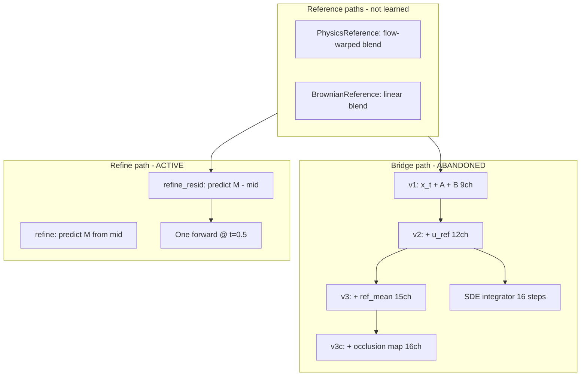

# Architecture evolution — models, conditioning, and results

This document synthesizes **every architectural change** to the learning stack in `physics-sb-stage1`: what changed in the network and inference path, whether it helped or hurt, and measured impact on FlyingThings3D midpoint interpolation (min flow 40px, cleanpass).

**Core UNet** (`model/unet.py`): DDPM-style encoder–decoder with time embedding, residual blocks, self-attention at coarse resolutions, zero-init output conv. The same backbone is reused across bridge and refine arms; differences are **inputs**, **targets**, **inference**, and **capacity**.

---

## 1. Architecture timeline (high level)



| Generation | Model | Input channels | Inference | Training target | Status |
|------------|-------|----------------|-----------|-----------------|--------|
| **v1 bridge** | `UNet` | 9 = `[x_t, x_A, x_B]` | 16-step integration | Drift residual vs `u_ref` | Superseded |
| **v2 bridge** | `UNet` | 12 = `[x_t, x_A, x_B, u_ref]` | 16-step integration | Same | **Trained; FAIL at eval** |
| **v3 bridge** | `UNetV3` | 15 = `[x_t, x_A, x_B, u_ref, ref_mean]` | 16-step integration | Same | Config only; same σ leak |
| **v3c bridge** | `UNetV3` | 16 (+ occlusion map) | 16-step integration | Same | Config only |
| **refine** | `UNet` (fast harness) | 12 = `[mid, x_A, x_B, u_ref]` | **One shot** | `M` (absolute) | Weaker than resid |
| **refine_resid** | `UNet` (fast harness) | 12 | **One shot** | `M - mid` (residual) | **Winner** |

---

## 2. Reference paths (conditioning signal, not the UNet)

These define `mid` and `u_ref` at `t=0.5`; the H2 question is physics vs brownian **reference**, not two different UNets.

| Reference | `mean(t=0.5)` | Typical static PSNR @ 128px | Role |
|-----------|---------------|----------------------------|------|
| **Physics** | Bidirectional flow warp of A, B | ~20.3 dB | Strong static prior |
| **Brownian** | `(1-t)A + tB` | ~17.9 dB | Weak static prior |

**H1 (no training):** Physics wins all four metrics (PSNR, SSIM, LPIPS, EPE). Benefit vs brownian **decreases** with motion magnitude (+3.5 → +1.6 dB across strata) — prior is informative but warp degrades at occlusion.

**Impact on misleading metrics:** Brownian’s lower static PSNR inflates **gain** (`trained − static`) in unpaired runs; fair paired comparison is mandatory for H2.

---

## 3. Bridge path architectures (negative overall)

### 3.1 Training–inference stack

1. Sample `t`, build Bezier interpolant `I_t` through GT midpoint `M` (`bridges/interpolant.py`).
2. **Bridge state:** `x_t = I_t + σ √(t(1−t)) ε` with default **σ = 0.1**.
3. Network predicts drift correction; loss matches bridge matching target using `u_ref`.
4. **Inference:** Euler–Maruyama over `t ∈ [0,1]` (`bridges/integrator.py`, 16 steps in `base.yaml`).

### 3.2 v1 → v2: add `u_ref` conditioning

| | v1 | v2 |
|---|----|----|
| **in_channels** | 9 | 12 |
| **Extra input** | — | `u_ref = reference.velocity(x_A, x_B, flow, t)` |
| **Params @ 256** | ~30M (base_ch=64, mult 1,2,4,4) | +3 input ch → negligible |

**Intent:** Tell the network the reference dynamics at the current bridge state.

**Result:** v2 is what was trained (`physics_v2_s0/s1`, `brownian_v2_s0`). At σ=0.1, **no meaningful gain** over static at free-running inference; physics ≈ brownian (~15.8 dB both). Conditioning on `u_ref` did not fix the failure mode.

### 3.3 v3: add `ref_mean` (aligned reference frame)

| | v2 | v3 (`UNetV3`) |
|---|----|----|
| **in_channels** | 12 | 15 |
| **Extra input** | — | `ref_mean = reference.mean(x_A, x_B, flow, t)` recomputed each integration step |
| **Rationale** | At large motion, raw `x_A`/`x_B` are misaligned; feed warped/blended content directly |

**Files:** `model/unet_v3.py`, `exps/1b_train_v3.py`, `exps/_inference_v3.py`, `configs/physics_v3.yaml`.

**Result:** **Not rescuing bridge.** `prereg.md` CORRECTION 3: v3/v3b/v3c keep σ=0.1; same `x_t` leak. No completed pilot eval showing free-running ≈ static. **Do not treat v3 as a fix** without new bridge parameterization.

### 3.4 v3c: add occlusion / warp-reliability map

| | v3 | v3c |
|---|----|-----|
| **in_channels** | 15 | 16 |
| **Extra input** | — | `reference_occlusion_map(...)` (`bridges/conditioning_v3c.py`) |

**Result:** Same expected failure class as v3 under current σ; not validated as positive.

### 3.5 σ ablation (bridge hyperparameter, not UNet width)

| σ | Free-running PSNR (physics, diag) | Teacher PSNR | Gate |
|---|-----------------------------------|--------------|------|
| 0.1 | ~16.0 dB | ~53.3 dB | FAIL |
| 0.3 | ~16.4 dB | ~53.0 dB | FAIL |
| 0.6 | ~16.0 dB | ~52.9 dB | FAIL |

**Finding:** Increasing σ did **not** restore free-running performance. Static prior ~19.7 dB; free **below** static by ~3.7 dB for all σ tested (`sigsweep.log`).

### 3.6 Root cause (architectural + path, not integrator bug)

| Component | Assessment |
|-----------|------------|
| **Integrator** | Correct (oracle drift rollout ~35 dB in diagnostics) |
| **x_t at t=0.5** | `I_0.5 = M` exactly → tiny noise still leaks GT into input |
| **Exposure bias** | Train on-path with true `I_t`; infer off-path with estimated state |
| **Sanity gate 3** | **Misleading** — zeroing `x_t` drops PSNR but does not imply good free rollout |

**Replacement gate:** `exps/diag_rollout.py` — require small teacher−free gap and free ≥ static − 0.5 dB.

### 3.7 Bridge summary table

| Change | Expected effect | Observed effect |
|--------|-----------------|-----------------|
| v2 `u_ref` | Better dynamics awareness | No free-running gain |
| v3 `ref_mean` | Better alignment at high motion | Not proven; same leak |
| v3c occlusion | Disocclusion hint | Not proven |
| σ ↑ | Less M leak | **No improvement** |
| 75k steps, EMA, base_ch=64 | Convergence | Fits teacher, fails free |

**Verdict:** Bridge architecture family **abandoned** for Stage 1 H2.

---

## 4. Refine path architectures (positive)

### 4.1 Problem addressed

Remove **open-loop integration** and **x_t** from the path. Train and test on the **same** input distribution.

### 4.2 `refine` (absolute midpoint)

```
x_in = mid (+ optional noise)
target = M
M_hat = f(x_in, t=0.5, x_A, x_B, u_ref)
```

| Aspect | Detail |
|--------|--------|
| **in_channels** | 12 (reuses v2-style stack; `x_t` slot filled with `mid`) |
| **Inference** | Single forward pass |
| **Risk** | Can predict arbitrary M; no floor at static prior |

**Result @ 64px, 3k steps (unpaired):** trained **20.37 dB**, gain **+0.19 dB** vs static — **worse** than `refine_resid` (+0.68 dB same config family).

### 4.3 `refine_resid` (residual on reference midpoint) — **winner**

```
x_in = mid (+ optional noise)
target = M - mid
M_hat = mid + f(x_in, t=0.5, x_A, x_B, u_ref)
```

| Aspect | Detail |
|--------|--------|
| **Inductive bias** | `f → 0` ⇒ static prior exactly |
| **Leakage** | `mid` does not encode GT `M` (physics warp / linear blend only) |
| **Integration** | None |

**Result:** Dominates fast cycles and fair H2; cannot fall below static the way integrated bridge does.

### 4.4 Comparison: refine vs refine_resid

| Variant | Physics trained @ 64px (wd=0.1, drop=0.2, 3k) | Gain vs static |
|---------|--------------------------------------------------|----------------|
| **refine** | 20.37 dB | +0.19 dB |
| **refine_resid** | 20.86 dB | **+0.68 dB** |

**Conclusion:** Residual parameterization is a **positive architectural change** independent of reference choice.

---

## 5. Model capacity & regularization (fast harness)

Default fast/fair UNet (not full `base.yaml`):

| Hyperparameter | Fast / fair | Full plan (`base.yaml`) |
|----------------|-------------|-------------------------|
| `base_channels` | **32** | **64** |
| `channel_mult` | **(1, 2, 2)** | **(1, 2, 4, 4)** |
| `num_res_blocks` | 1 | 2 |
| `attn_resolutions` | (16,) | (16, 8) |
| `time_emb_dim` | 128 | 256 |
| ~Params @ 256 | ~few M | ~30M |

### 5.1 `base_ch` (width)

| base_ch | Physics @ 64px (charb, 6k steps) | vs ch=32 |
|---------|----------------------------------|----------|
| **16** | 20.14 dB, gain **−0.03 dB** | Too narrow |
| **32** | 20.69–20.83 dB, gain +0.5–0.65 dB | Sweet spot |
| **48** | 20.81 dB, gain +0.64 dB | ~same as 32 |

**Impact:** Widening 32→48 did not materially help at 64–128px; narrow 16 **hurts**.

### 5.2 Dropout & weight decay

| Config | Trained PSNR | Gain |
|--------|--------------|------|
| wd=0.01, drop=0.0 | 20.18 dB @ 3k | +0.00 dB |
| **wd=0.1, drop=0.2** | **20.86 dB** @ 3k | **+0.68 dB** |

**Impact:** Strong regularization is a **positive** change for refine_resid (reduces overfit to residual).

### 5.3 Loss & schedule

| Loss | LR schedule | 64px gain (typical) |
|------|-------------|---------------------|
| mse | none | +0.62–0.68 dB |
| **charb** | **cosine** | +0.52–0.86 dB @ 128px |
| l1 | cosine | ~same as charb |

**Impact:** charb + cosine **positive** at 128px fair runs.

### 5.4 Input noise augmentation

| noise | Fair 64px Δ | Fair 128px |
|-------|-------------|------------|
| 0.0 | +1.55 dB | +1.73–1.76 dB |
| 0.1 | +1.55 dB | ~same |

**Impact:** Mild noise **neutral** on H2 delta; optional robustness.

### 5.5 EMA (eval weights)

Used in fair_pair / fast_cycle (`ema_decay=0.999`). Standard stabilizer; no ablation table, assumed **positive/neutral**.

---

## 6. Inference & evaluation architecture

### 6.1 Bridge: multi-step SDE (negative at current σ)

- 16-step grid, read `M` at `t=0.5` after integration.
- Compounding error + train/test state mismatch.

### 6.2 Refine: one-shot (positive)

- Fixed `t = 0.5`; no integrator.
- Train and eval inputs match.

### 6.3 Eval batching bug (operational, not model)

| Setting | 256px eval | Result |
|---------|------------|--------|
| `eval_batch=64` (hardcoded) | OOM after successful train | False “scale fail” |
| **`eval_batch=4`** | Probe completes | **+1.82 dB** fair Δ |

**Fix:** `fair_pair.default_eval_batch(size)` + eval after each model + `empty_cache()`.

---

## 7. Results by architecture decision

### 7.1 Bridge v2 (full model, σ=0.1) — **negative**

| Metric | Physics trained | Physics static | Brownian trained | Brownian static |
|--------|-----------------|----------------|------------------|-----------------|
| Free-running PSNR | **~15.8 dB** | **~19.7 dB** | **~15.8 dB** | **~17.4 dB** |
| Teacher-forced | ~53 dB | — | ~53 dB | — |

Physics **≈** brownian; both **lose** to own static prior.

### 7.2 refine_resid + fair paired — **positive**

| Resolution | mean Δ (phys−brwn) | Physics | Brownian | Wins |
|------------|-------------------|---------|----------|------|
| 64px | +1.55 dB | 20.87 | 19.32 | ~195/200 |
| 128px | **+1.73–1.76 dB** | **21.21–21.23** | 19.45–19.49 | 192–196/200 |
| 256px (4k probe) | **+1.82 dB** | 20.39 | 18.58 | 190/200 |

**Scalability:** 64→128→256 H2 signal **preserved** (not collapsing). Absolute PSNR does not increase monotonically with resolution (evaluation at native res; static ~19.6 @ 256 probe).

### 7.3 Unpaired fast-cycle (physics, refine_resid) — useful for tuning only

| size | Best trained | Gain vs static | Notes |
|------|--------------|----------------|-------|
| 64px | 20.95 dB | +0.77 dB | n_train=6000 |
| 128px | **21.17 dB** | **+0.86 dB** | charb, 8k, n_train=6000 |

Cross-reference **gain** ranking is **invalid** for H2 (brownian +1.4 dB gain but lower absolute PSNR).

---

## 8. What we kept vs dropped

| Kept | Dropped |
|------|---------|
| `UNet` backbone + time cond | Bridge open-loop inference |
| `u_ref` conditioning (12ch) | v1 9ch-only bridge |
| `refine_resid` head | Absolute `refine` target |
| Physics vs brownian **reference** as H2 axis | σ-only bridge fixes |
| Fair paired protocol | v3 bridge without σ/path fix |
| Fast harness: base_ch=32, charb, wd/drop | base_ch=16 |
| Eval micro-batching @ 256 | eval batch 64 @ 256 |

---

## 9. Recommended architecture for full 256px pilot

From probe + 128px fair winner:

```yaml
variant: refine_resid
in_channels: 12          # mid, x_A, x_B, u_ref @ t=0.5
base_channels: 32        # probe passed; consider 48 if full run underperforms
channel_mult: [1, 2, 2]
loss: charb
lr_schedule: cosine
weight_decay: 0.1
dropout: 0.2
steps: 12000             # scale gate default after probe
train_batch: 4           # 256px VRAM
eval_batch: 4
inference: one forward, M_hat = mid + out
```

**Optional upgrades (not yet validated):**

- `base_ch=64`, full `base.yaml` depth — if 32ch plateaus on 1000-clip eval.
- Progressive init: train 128px → finetune 256px (`--init_ckpt` not implemented).
- v3-style `ref_mean` **as input instead of mid** in refine arm — different inductive bias; not tested.

---

## 10. File map

| Component | Path |
|-----------|------|
| UNet v2 | `model/unet.py` |
| UNet v3 | `model/unet_v3.py` |
| References | `bridges/reference.py` |
| Bridge train | `exps/1b_train.py`, `exps/1b_eval.py` |
| Bridge v3 train | `exps/1b_train_v3.py` |
| Integrator | `bridges/integrator.py`, `exps/_inference.py` |
| Rollout diagnostic | `exps/diag_rollout.py` |
| Refine full | `exps/1c_refine.py` |
| Refine fast / fair | `exps/fast_cycle.py`, `exps/fair_pair.py`, `exps/fair_pair_full.py` |
| Configs | `configs/base.yaml`, `physics_refine.yaml`, `physics_v3.yaml`, `physics_sig*.yaml` |

---

## 11. One-paragraph summary for agents

The project tried **bridge matching** with a ~30M UNet predicting drift from `[x_t, x_A, x_B, u_ref]` plus v3 extras; **open-loop integration failed** because `x_t` at σ=0.1 leaks the GT midpoint and teacher-forced training does not transfer (free ~16 dB vs static ~20 dB; σ sweep failed). The successful pivot is **`refine_resid`**: same UNet family with input `mid` (reference midpoint), target `M−mid`, **one-shot inference** — no exposure bias. **Physics beats brownian** under fair paired eval by **+1.5–1.8 dB** at 64/128/256px. Capacity **base_ch=32** suffices in the fast harness; **wd=0.1, drop=0.2, charb+cosine** help; **residual form** beats absolute `refine`. v3 `ref_mean` and bridge integrator are **not** part of the winning stack unless re-tested inside refine.

---

## 12. Architecture cycling (Stage 2) — the midpoint *prior*

After the hand-crafted acceleration prior (`PhysicsReferenceV2`, A1) **lost** to V1,
we cycled *learned* midpoint architectures (`model/synth.py`, `model/latent_bridge.py`;
harnesses `exps/arch_cycle.py`, `exps/latent_stage.py`). All variants use a
**residual-around-V1** design (zero-init head ⇒ identical to the physics-V1 warp+blend
at init — a strict floor). Ranked by midpoint PSNR vs GT @64px; V1 floor = 20.177 dB.

| arch | idea | vs V1 | hi[100,∞) vs V1 | note |
|------|------|-------|------------------|------|
| `flow_synth` | learn `F_{A→M}` (resid of `0.5·F_AB`), warp+blend | +0.107 | +0.057 | first trained prior to beat V1; saturates ~+0.1 |
| `flow_synth_occ` | + per-pixel occlusion blend mask | −0.009 | −0.069 | best SSIM 0.643 (helps structure, not PSNR) |
| `feat_warp` | Opt 3: warp/blend features, decode (no skips) | −0.283 | **+0.362** | occlusion-robust on hard motion; lossy AE blurs easy |
| `feat_flow` | Opt 2+3 in feature space | −0.799 | −0.290 | compounded error; worst |
| `feat_resid` | feature decode as resid on V1 floor | −0.449 | −0.605 | **overfits** (lowest train loss, worst test) |
| **`LatentPrior` (S1)** | Opt 3 + cross-attn + FiLM(flow) + **resid decode + pixel skips** | **+0.43** | **+0.34** | **best prior**, best SSIM 0.66 |

**Key architectural lessons:**
1. **Residual-on-the-warp-floor is mandatory.** A free decoder (`feat_resid`) overfits
   and drops below the floor despite a zero-init head — anchoring holds only at init.
2. **A learned warp (`flow_synth`) generalizes but has a low ceiling (~+0.1).** It can
   only resample existing pixels; real gains need correspondence + correction.
3. **Faithful codec + pixel skips fix Option 3.** `SharedAE` round-trips at 50 dB
   (S0 AE-GATE PASS); warped-blended pixel skips keep easy regions lossless, so the
   latent path spends capacity on occlusion → S1 wins +0.43 and the hard stratum +0.34.
4. **The encoder must be trainable.** Frozen-encoder S1 = +0.16 vs trainable +0.43;
   pretraining (warm) ≈ scratch (+0.42 vs +0.43) — the gain is the architecture, not S0 weights.

### Latent bridge (Stage 2C, `LatentBridge` / S2) — C-GATE **FAIL**

Adding a latent denoiser that refines `z_mid → z_M` (`z_t = z_mid + σε`, noised from
the **prior**, never a GT interpolant; zero-init residual ⇒ starts exactly at the S1
prior) **did not beat the one-shot prior**: −0.20 dB (σ_max 0.5/1.0, frozen prior),
and joint fine-tuning diverged (NaN). This **repeats the Stage-1 verdict**: the
bridge/SDE/denoise framing keeps failing the one-shot-prediction gate. Note a target
bug in the first S2 (`MSE(z_M_hat, encode(x_M))` is inconsistent with the decoder's
source-warped skips); the `lat_w=0` retest is the clean check.

**Net:** the best architecture for the midpoint is the **`LatentPrior` (Option 3 +
cross-attention, residual-decode-on-warp-floor with pixel skips)**, used **one-shot**;
the latent bridge on top is, so far, dead weight — consistent with `refine_resid` ≻ bridge.

---

*Last updated from `cycles.log`, `arch_cycles.log`, `resume_full.log`, `sigsweep.log`, `prereg.md` CORRECTIONS, and fast-cycle RESULT lines.*
